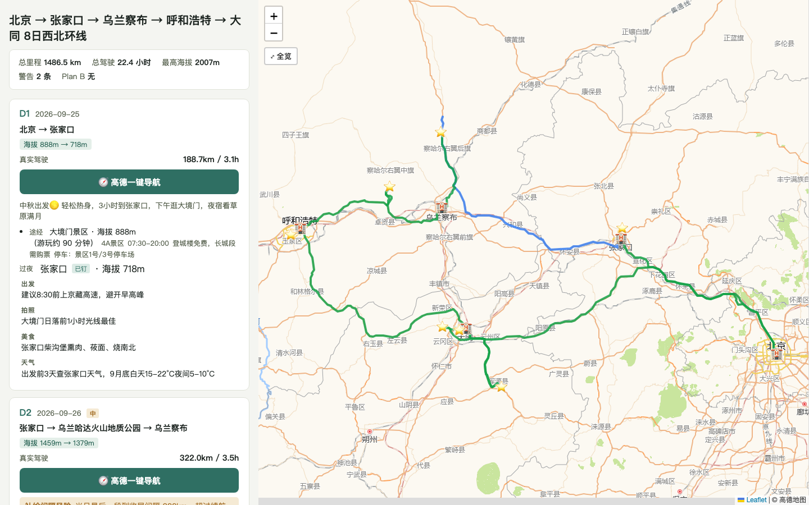

# roadbook · Verified Road-Trip Planning Pipeline

[中文（主文档）](README.md)

Give it a one-line trip request — or paste in any itinerary written by an AI or a stranger — and it produces a **fact-checked, visual, iterable** road book: a self-contained HTML file that opens with a double-click, works on phones, and can be shared directly.




## Why

AI-generated itineraries look plausible but the numbers are made up. Real case: a guide claimed "250 km / 3.5 h" for a leg that actually measures 352 km — the AI forgot the lake was in the opposite direction. Operational facts (which gate allows entry, reservation mini-programs, bloom windows) also rot quickly in training data.

Three guarantees:
1. **Numbers come from tools only** — distance/duration/elevation/coordinates from AMap APIs and scripts; the LLM never invents figures;
2. **Operational claims are individually verified** — 8 mandatory categories (gate access / shuttle / reservation / permits / seasonal roads / phenology / refueling / altitude), each verdict carries source quotes and a check date; "unverified" is always preferred over a false "contradicted";
3. **Exception-based marking** — verified items render quietly; only problems get ❓❌⏳ badges.

## Install

Two sources, same content (Gitee recommended for mainland-China networks):

```bash
# Gitee (mainland China)
git clone https://gitee.com/crawlerxii/roadbook.git ~/.claude/skills/roadbook

# GitHub
git clone https://github.com/hawkeye-xb/roadbook.git ~/.claude/skills/roadbook
```

Claude Code picks up user-level skills automatically in new sessions.

## What your agent needs

| Capability | Status | Notes |
|---|---|---|
| python3 | Required | All scripts are dependency-free |
| AMap Web-Service key | Required | Free personal tier is plenty (~10 min to obtain, see `references/amap-mcp-usage.md`). Without it you get **preview mode**: skeleton only, estimated durations, persistent warning banner |
| Web search | Strongly recommended | Powers retrieval verification (reservations / closures / bloom windows) |
| Xiaohongshu-style UGC search | Optional | Freshness signal for operational facts; admission rules in `checklists/categories.md` |
| Page deployment (gh/wrangler) | Optional | Offer a shareable URL only after the user is satisfied |

## Usage — three entrances, zero commands to memorize

- **Plan from scratch**: "Plan a 15-day Xinjiang road trip in June"
- **Verify an existing guide**: paste any itinerary + "is this reliable?"
- **On-the-road edits**: "Add a stop at Anjihai Canyon on Day 3" — only affected segments are recomputed

## On the phone

The same HTML switches to a phone layout: a 30% map pinned on top, one line per day (date · route · distance), and tapping a day expands it — navigation button, stops, overnight. Tips and verification evidence fold one level deeper; risks and warnings always stay in the expanded view.

- **One-tap AMap navigation**: a button on every day that has coordinates, with that day's waypoints in order, ending at its last stop;
- **Origin follows the date**: today routes from your current location; other days start from that day's own start point, so you never see a route "from my home to the destination" that isn't in the book. Days without a start point (in-town sightseeing) still use the current location.

## How it works

```
L0 constraints  (one batched round of questions; ask travelers separately when preferences differ)
L1 skeleton     (2-3 trade-off options derived from real driving budgets)
L2 fill         (daily POIs & routes; 3-step coordinate verification; real road geometry)
L3 verification (9 computable rules + 8 retrieval categories; claims carry evidence chains)
L4 refinement   (touch only affected days; visual diff; one-command pre-departure recheck)
—— every layer renders HTML; rendering is the confirmation medium ——
```

Single source of truth: `work/itinerary.json`. The HTML is always a projection of it.

## Tested across models

Same skill, different agents (Aug 2026):

| Model | Test route | Result |
|---|---|---|
| Claude (Fable 5) | Guangxi border & coast, 13d, EV | Fully compliant: 11 verified claims (1 pending), real geometry, lowland elevation auto-hidden |
| DeepSeek V4 Pro | Northwest loop, 8d | Structurally compliant, 4 claims verified with evidence; ~157.6k in / 43.9k out tokens |
| Kimi K3 | Northeast loop, 13d | Rendering/interaction/elevation compliant; **retrieval verification silently skipped** (0 claims) |

Honest takeaway: script-enforced parts (rendering, computable checks, geometry, elevation gating) are model-agnostic; retrieval-verification depth varies with model capability. The renderer now shows a mandatory warning banner whenever a road book carries zero verification records.

## Version & updates

Current version lives in the `VERSION` file (semver). To update:

```bash
cd ~/.claude/skills/roadbook && git pull
```

Updates take effect in new sessions (pull from whichever source you cloned). Your trip data stays in your own `work/` directory — updating the skill never touches generated road books.

> Maintainer note: GitHub is the primary repo; Gitee is a mirror — click "Sync" on the Gitee repo page after each GitHub push.

## Known limits

- Road network data currently AMap only (mainland China);
- Retrieval verification relies on LLM semantic judgment; `examples/xinjiang-16d/` serves as the regression baseline.

## License

[MIT](LICENSE)
