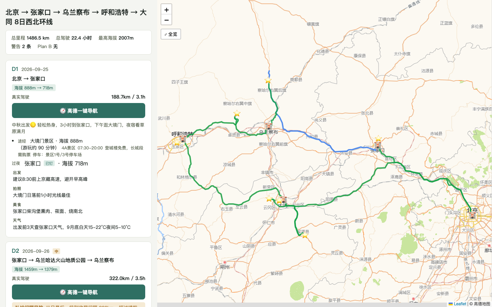

# roadbook · 自驾路书流水线

[English](README.en.md)

输入一句旅行需求，或丢进来一份 AI/网友写的攻略，产出**信息经核验、可视化、可迭代**的自驾路书（自包含 HTML，双击浏览器打开，手机可看，可直接发微信）。




## 为什么需要它

AI 聊天生成的攻略看着像模像样，但数字是顺口编的：实测案例里，某攻略写"250km / 3.5h"，高德实测 352km——它忘了天池在乌鲁木齐东北方向，去奎屯要折返。门禁方向、预约小程序、花期窗口这类运营信息，训练数据里的版本也往往过期。

本 skill 的三条保障：
1. **数字全部来自工具**——距离/时长/海拔/坐标由高德和脚本产出，禁止 LLM 填数；
2. **运营信息逐条核验**——8 类必检项（门禁动线/换乘/预约/证件/季节封路/物候/补能/海拔），每条结论带来源引文和核验日期，宁标"待核实"不误报；
3. **例外标注**——核验通过的安静呈现，只有问题项才打 ❓❌⏳ 标记。

## 安装

两个源任选（内容同步，国内网络推荐 Gitee）：

```bash
# Gitee（国内推荐）
git clone https://gitee.com/crawlerxii/roadbook.git ~/.claude/skills/roadbook

# GitHub
git clone https://github.com/hawkeye-xb/roadbook.git ~/.claude/skills/roadbook
```

Claude Code 自动识别用户级 skill 目录，新会话即可触发。

## 你的 agent 需要什么能力

| 能力 | 地位 | 说明 |
|---|---|---|
| python3 | 必备 | 所有脚本零第三方依赖，系统自带即可 |
| 高德 Web 服务 key | 必备 | 免费个人开发者额度够用，申请约 10 分钟，引导见 `references/amap-mcp-usage.md`。没有它进"预览模式"：只出骨架、路耗标估算、页面持续横幅警示 |
| 联网搜索 | 强烈建议 | 检索核验（预约规则/封路/花期）靠它；没有则检索类核验跳过并如实标注 |
| 小红书类 UGC 检索 | 可选增强 | 时效性运营信息（门禁/预约/排队）的现场信号源，采信规则见 `checklists/categories.md` |
| 网页部署（gh/wrangler） | 可选 | 用户对路书满意后，可发布为 URL 方便分享；没有就交付本地文件 |

## 怎么用（三种入口，一个都不用记命令）

- **从零规划**："帮我规划 6 月新疆 15 天自驾，想看薰衣草"
- **核验既有攻略**：粘贴任何来源的攻略 +"帮我看看靠谱吗"
- **路上改**："Day 3 顺路加个安集海大峡谷"——只重算受影响的部分

## 手机上用

同一份 HTML 在手机上换成另一套布局：地图收在顶部 3 成，每天收成一行（日期 · 路线 · 里程），点开一天才看导航按钮、途经点与过夜；当日建议和核验依据再收一层，风险与警告始终留在展开面里。

- **高德一键导航**：有可导航行程且终点经高德核验的日子各一个按钮，已核验途经点按顺序带进高德 App。路段端点做主序，未被路段覆盖的已核验景点插在终点前；只有过夜点的休息日，或终点未核验的日子不出按钮；
- **起点按日期变**：卡片日期是今天就从当前位置出发，其他日期按当天行程起点规划，避免算出"从我家到目的地"这种书外路线。日期缺失、城内日这类没有固定起点的情况，仍从当前位置出发。

## 开发自验

```bash
python3 -m unittest discover -s tests
node --test tests/test_inline_js.js
```

运行路书只依赖 Python；第二条命令用 Node 内置测试器执行内联 JS 回归，无需安装 npm 包。

## 工作原理（一图流）

```
L0 约束（一批问全：日期/车/人/玩法偏好，同行人分歧分别问）
L1 骨架（按驾驶预算推导 2-3 个带取舍的方案供选，真实路耗）
L2 填充（逐日景点动线，坐标三步验证，真实道路几何）
L3 核验（9 条可计算规则 + 8 类检索核验，claim 带证据链）
L4 微调（只动受影响天，diff 可视化；出发前一键复检过期项）
—— 每一层都渲染 HTML，渲染是确认的媒介，不是完工奖励 ——
```

事实源唯一：`work/itinerary.json`。HTML 永远是它的投影，改行程=改 JSON 重渲染。

## 跨模型实测

同一份 skill，不同模型的 agent 实测结果（2026-08）：

| 模型 | 测试路线 | 结果 |
|---|---|---|
| Claude（Fable 5） | 广西边关滨海 13 天·电车 | 全流程合规：11 项检索核验（1 项待确认）、真实几何、低地海拔自动隐藏 |
| DeepSeek V4 Pro | 西北环线 8 天 | 结构全合规、4 项核验带证据通过；消耗约 157.6k 输入 / 43.9k 输出 tokens |
| Kimi K3 | 东北环线 13 天·赏秋 | 渲染/交互/海拔条件化合规；**检索核验被静默跳过**（0 条 claims） |

诚实结论：**脚本兜底的部分（渲染、可计算校验、真实几何、海拔条件化）模型无关，全数通过；判断密集的检索核验深度随模型能力波动**。针对 Kimi 暴露的静默跳过问题，渲染层已加兜底——整本路书没有任何核验记录时，页面强制显示"未附检索核验记录，出发前请自行核实"警示条。

## 版本与更新

当前版本见 `VERSION` 文件（语义化版本号）。更新（从你 clone 时选的源 pull 即可）：

```bash
cd ~/.claude/skills/roadbook && git pull
```

更新在新会话生效。行程数据在你自己的工作目录 `work/` 下，更新 skill 不影响已生成的路书。

> 维护说明：GitHub 为主仓库，Gitee 为镜像；GitHub 推送后在 Gitee 仓库页点"同步"按钮即可对齐。

## 已知局限

- 路网数据源目前仅支持高德（中国大陆）；
- 检索核验依赖 LLM 语义判定，`examples/xinjiang-16d/` 的预期行为文档是当前回归基线。

## License

[MIT](LICENSE)
